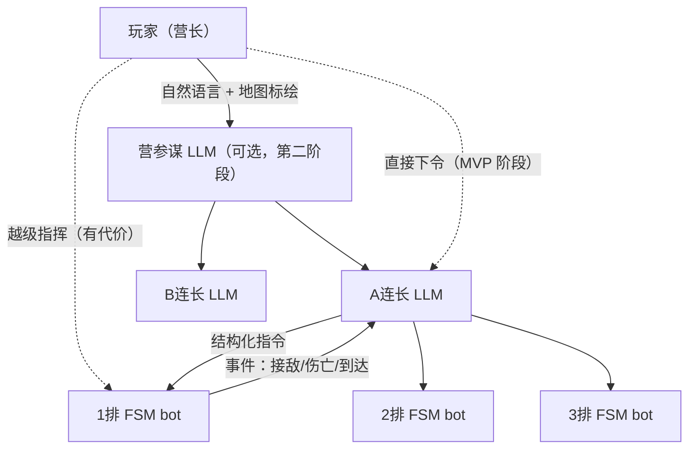
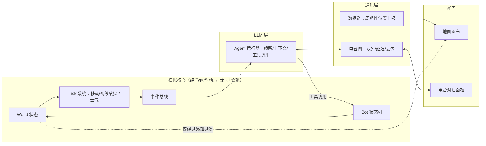

# LLM 指挥链战术 RTS —— 需求分析与实施建议

## 0. 一句话定位

> 一个**节奏慢、规模中等、拟真简化**的 2D 战术 RTS，玩家看的是一张"参谋地图"而不是上帝视角；玩家用**自然语言 + 地图标绘**向 LLM 指挥官下令，LLM 再把意图翻译成**状态机 bot** 能执行的指令。

你的设计本质上是在"玩家 → 单位"之间插入了两个**有损信道**：
1. **语义信道**（LLM 理解与执行意图的偏差）
2. **物理信道**（电台延迟、带宽、断联、信息陈旧）

游戏乐趣就来自"在有损信道下仍然把仗打赢"。下面所有建议都围绕"如何让这两个信道**可控、可调、可玩**"。

---

## 1. 需求逐条分析

### 1.1 战场：慢、稍大、简化

| 维度 | 建议 | 理由 |
|---|---|---|
| 最小模拟单位 | **排 (platoon)** 为一个实体，不模拟单兵/单车 | 规模大而实体少；LLM 上下文也不会爆 |
| 规模 | 每方 2–4 个连，共 20–50 个排级实体；地图 8–15 km | 足够慢，足够需要"委托" |
| 时间 | 实时 + 暂停 + 0.5x/1x/2x/4x 变速 | LLM 调用 2–10 秒，正好伪装成"电台延迟"，这是**特性不是缺陷** |
| 战斗 | 每个实体：兵力值、压制值、士气、弹药；伤害用简化 Lanchester / 概率表 | 不做弹道，不做装甲角度 |
| 地形 | 网格（如 50m/格）：高度 + 地类（开阔/林地/城镇/道路/水） | 一张网格同时支撑寻路、视线、掩护 |
| 视线 | 网格上做射线检测 + 林地/城镇遮挡 | 这是"战争迷雾"的根基，必须有 |

> [!TIP]
> 拟真度的判据只有一条：**这个机制会不会让 LLM 和玩家的对话变得更有意思？** 例如"压制"值得做（"我们被压住了，动不了"），"弹道下坠"不值得做。

### 1.2 指挥链：扁平，1–2 层 LLM



- **MVP 只做一层 LLM（连长）**，玩家直接指挥 3–4 个连长。第二层（营参谋）是之后的扩展，用来测试"多一层是否更好玩"。
- **底层 bot 必须足够强**：寻路、遇敌自动还击、被压制自动找掩护、弹药不足自动报告。LLM 只做"去哪、做什么、什么时候"，绝不微操。
- **越级指挥的代价**（让它成为一个决策而不是默认操作）：
  - 占用玩家/电台带宽；
  - 连长 LLM 不知情（除非你另行通报），可能下达冲突命令；
  - 可选：连长的"信任/士气"下降，汇报变少。

### 1.3 受限沟通：有限观察 + 不完全数据链

这是游戏的"灵魂旋钮"，建议把它拆成若干**独立可调的参数**：

| 信息类型 | 玩家地图上的表现 | 可调参数 |
|---|---|---|
| 友军位置 | 数据链自动上报（"蓝军跟踪"），但**有刷新间隔、会断联** | 刷新周期、断联概率、范围 |
| 友军状态（兵力/弹药） | **不自动显示**，需要询问或等待汇报 | — |
| 敌情 | 只显示"接触报告"：位置有误差圈、类型可能不准、随时间变淡 | 误差、衰减时间 |
| 命令/汇报 | 走电台网：**同一网同一时刻只能一个人说话**，排队 | 延迟、队列长度、干扰 |

时代背景建议：**架空的 1990 年代末/2000 年代初**。这刚好是"有早期数据链（如 FBCB2 雏形）但不完善、主要还靠语音电台"的时期，和你描述的"部分信息化"完全吻合；架空则免去考据负担。

> [!IMPORTANT]
> **地图上的公共词汇表**是整个设计里最容易被忽视、却最关键的一点：玩家、LLM、bot 必须能用同一套语言指代地点。
> - 地图要有**命名地物**："112高地"、"阿尔法桥"、"红磨坊村"；
> - 有**网格坐标**（如"4527"）；
> - 玩家可以**标绘作战图形**（目标点、阶段线、集结点、边界线），这些图形自动成为 LLM 上下文的一部分。
>
> "A连，占领目标 OBJ-鹰，越过阶段线 PL-蓝 后报告" —— 这句话能被理解，游戏就成立了一半。

### 1.4 LLM 的三种能力 → 三组工具 (function calling)

你定义得非常清楚，直接映射成 tool calling：

| 能力 | 工具示例 | 说明 |
|---|---|---|
| 获取职责内情况 | `get_situation()`、`get_unit_status(unit)`、`get_terrain(area)`、`get_graphics()` | 返回的是**该指挥官视角的文本化态势**，不是全局状态 |
| 沟通 | `report_to_superior(text, priority)`、`request_support(type, target)` | 消息进入电台队列，会延迟/丢失 |
| 动作 | `order_move(unit, dest, route?, speed)`、`order_attack(unit, target_area)`、`order_hold(unit, pos)`、`order_withdraw(...)`、`set_roe(unit, roe)` | 只能对**自己的下属**下令；参数必须是坐标/地物名/图形名 |

LLM **何时被唤醒**（关键的成本控制点）——事件驱动，不按帧调用：
- 收到上级消息；
- 下属发出重要事件：接敌、伤亡超阈值、任务完成、弹药告急、失联；
- 兜底心跳：每 N 秒游戏时间一次"态势检查"（可以用更便宜的模型）。

---

## 2. 最大的设计风险（提前想清楚）

1. **"LLM 太好用" → 退化为语音控制 RTS**：如果连长永远完美执行，指挥链就失去意义。
   - 解法：**不要故意让 LLM 犯傻**，而是**限制它的信息**（它只知道下属看到的东西）、给它**性格与经验参数**（谨慎/激进、新兵/老兵写进 system prompt）、让它**对模糊命令自行判断**。
2. **"LLM 太蠢" → 挫败感**：命令被误解、乱下令。
   - 解法：强 bot 层兜底；工具参数严格校验（非法参数直接返回错误让 LLM 重试）；LLM 复述命令（"收到，A连向112高地前进"）给玩家纠错机会——这本身就是真实无线电规程。
3. **延迟与成本**：50 个实体 × 频繁调用不可行。
   - 解法：只有连长级以上用 LLM（一局 3–8 个 agent）；事件驱动；记忆做滚动摘要；并发上限。
4. **敌方 AI**：敌人也用 LLM 很贵也难调。
   - 解法：MVP 阶段敌方用**脚本 + 同一套 FSM bot**（预设防线、反击触发器）；之后再尝试"敌方 LLM 指挥官"。

---

## 3. 技术方案（拿来主义版）

### 3.1 总体架构



关键原则：**模拟核心与渲染完全分离**。核心可以在 Node 里无头运行——这对后端出身的你是最舒服的：你可以先写测试、在终端里跑一局"纯文字战争"、调 prompt，完全不碰前端。

### 3.2 技术栈推荐

| 部分 | 选择 | 为什么 |
|---|---|---|
| 语言 | **TypeScript** | 类型系统对后端开发者友好；前后端/Node 通用 |
| 构建 | **Vite** | 零配置，`npm create vite@latest` 一条命令起项目 |
| UI 框架 | **React** | 资料/示例最多，AI 生成代码质量最高；只用于面板（对话、单位列表） |
| 地图渲染 | **PixiJS**（2D WebGL） | 只是画图，不像 Phaser 带一整套游戏框架；性能足够 |
| 军标 | **[milsymbol](https://github.com/spatialillusions/milsymbol)** | 直接生成北约 APP-6 / MIL-STD-2525 军标 SVG —— **一行代码解决全部美术**，且天然契合"参谋地图"气质 |
| 地形生成 | **simplex-noise** 生成高度图；或用 **Tiled** 编辑器手绘 | 先噪声，后手绘关卡 |
| 寻路 | **pathfinding** 或 **easystar.js**（网格 A*） | 拿来即用 |
| 状态机 | 先**手写 switch 状态机**；复杂后再考虑 **XState** | 排级 bot 状态不多，手写更易懂 |
| LLM 调用 | **Vercel AI SDK (`ai`)** + **zod** | 统一封装 OpenAI/Anthropic/Google/DeepSeek/Ollama；tool calling + 参数校验开箱即用 |
| 状态管理 | **zustand**（UI 侧） | 比 Redux 简单得多 |

> [!NOTE]
> **API Key 问题**：纯浏览器直接调 LLM 会暴露 key。实验阶段可以接受（本地运行、用户自填 key），或者起一个几十行的 Node 代理（你熟悉的领域）。本地 **Ollama** 跑小模型可以零成本调试。

### 3.3 建议的目录结构

```
wargame/
├─ src/
│  ├─ sim/            # 模拟核心（无 UI 依赖，可在 Node 中运行）
│  │  ├─ world.ts     # 实体、地图、时间
│  │  ├─ terrain.ts   # 网格、高度、视线
│  │  ├─ combat.ts
│  │  ├─ bot/         # 排级状态机
│  │  └─ events.ts
│  ├─ comms/          # 电台网、数据链
│  ├─ agents/         # LLM agent：prompt、工具定义、唤醒策略、记忆
│  ├─ perception/     # “某人能知道什么” → 文本化态势
│  ├─ ui/             # React 面板
│  └─ render/         # PixiJS 地图 + milsymbol
├─ scenarios/         # 关卡 JSON（地图、部署、命名地物）
└─ scripts/           # 无头运行、prompt 测试
```

`perception/` 单独拎出来：**"给谁看什么"** 这一个函数同时决定了玩家地图显示什么、LLM 上下文里有什么，是整个游戏信息不对称的唯一闸门。

---

## 4. 路线图（每一步都可玩/可验证）

| 阶段 | 内容 | 验证点 |
|---|---|---|
| **M0 文字战争** | 无头模拟核心 + 终端里和 1 个连长 LLM 对话；连长指挥 3 个排打一个脚本敌人 | **核心乐趣是否存在**——此时其实就是一个 LLM 版 Radio Commander。不好玩就先别画地图 |
| **M1 参谋地图** | Vite + PixiJS + milsymbol 渲染网格地形与单位；React 电台面板 | 能在浏览器里玩 M0 |
| **M2 信息不对称** | 感知过滤、迷雾、接触报告误差/衰减、数据链刷新 | 玩家是否需要"问"才能知道情况 |
| **M3 通讯瓶颈** | 电台网队列/延迟/干扰、越级指挥代价 | 沟通是否成为决策资源 |
| **M4 作战图形** | 玩家标绘目标/阶段线，进入 LLM 上下文 | 下令效率与精度明显提升 |
| **M5 扩展** | 多连 + 营参谋 LLM 层、炮兵/支援请求、敌方 LLM、关卡编辑 | 第二层 LLM 是否增加乐趣 |

> [!TIP]
> M0 最值得投入。它验证的是最贵、最不确定的假设（"和 LLM 部下对话好不好玩"），而成本只是几百行 TypeScript，全在你熟悉的"后端式"代码里完成。

---

## 5. 需要你拍板的问题

1. **时代背景**：架空 90 年代末/2000 年代初（推荐），还是指定某个真实战场？
2. **LLM 提供方**：云端 API（哪家？）、本地 Ollama，还是两者都支持？
3. **敌方 AI**：MVP 阶段接受脚本化敌人吗？
4. **语言**：游戏内对话用中文还是英文（影响 prompt 与模型选择）？
5. **是否从 M0（纯文字原型）开始**？如果同意，我可以直接搭项目骨架并实现第一个可运行的"连长 agent + 3 个排 bot"原型。
