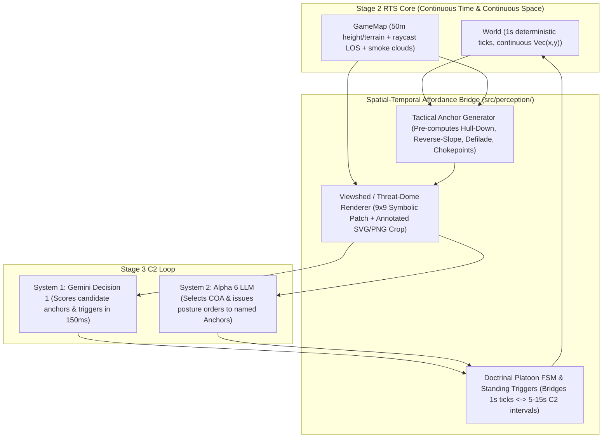

# Axis 1 Deep Dive: Discrete vs. Continuous Space-Time & Multimodal Viewshed Grounding

- **Parent Master Issue**: [#5](https://github.com/Mikhail-YellowBegonia/llm_wargame_test/issues/5)
- **Charter Reference**: [`00-research-charter.md`](./00-research-charter.md)

---

## 1. The Core Tension: Continuous Eugen-Style RTS vs. Discrete AI Reasoning

Modern tactical wargames in the **Eugen Systems** lineage (*Wargame: Red Dragon*, *WARNO*, *Regiments*) operate in **continuous time** (real-time ticks where projectiles, movement, suppression, and smoke evolve simultaneously) and **continuous space** (Euclidean $(x, y, z)$ coordinates where a 20-meter shift across a treeline or ridge crest determines whether an ATGM team has line-of-sight or sits in dead ground).

By contrast, foundation models (both LLMs and VLMs) exhibit a well-documented **discrete bias**:
1. **Symbolic & Topological Native Representation**: Transformers process discrete token sequences. In board games (Chess FEN/PGN, hex-and-counter wargames), the state space is a small graph of discrete states and legal moves.
2. **Continuous Coordinate Blindness (`arXiv:2512.24532`, `arXiv:2607.22732`)**: When an LLM is given continuous coordinates (e.g., `Alpha 1 at (1420, 2180), Enemy Tank at (2650, 3110)`) and a list of terrain polygons or heightmap points, it cannot reliably perform Euclidean raycasting, line-segment intersection, or elevation slope integration in its weights.
3. **Temporal Mismatch (`Sean Goedecke 2025`, `RTSGameBench arXiv:2606.18950`)**: A continuous RTS ticks every $0.1\text{--}1.0\text{ s}$, whereas a deliberative LLM turn takes $1.5\text{--}8.0\text{ s}$. If the LLM must micro-step units across continuous space or continuous time, it suffers from **action starvation** and **order thrashing** (issuing a move order based on a state that is already 5 seconds stale).

---

## 2. Literature Evidence: How Researchers Measure & Bridge the Adaptation Cost (适配代价)

### 2.1 Spatial Discretization & Scene Graphs (`MapBench` & `Text2Space`)
- **`MapBench: Can Large Vision Language Models Read Maps like a Human?` (`arXiv:2503.14607`)**:
  - Evaluated GPT-4o, Qwen2-VL, and Llama-3.2-Vision on 1,649 pathfinding queries over 100 complex 2D maps.
  - **Key Finding**: Raw pixel maps alone yield poor path quality ($PQS = \ell(L_{MSSG})/\ell(L_{sp})$ far above $1.0$, with frequent missing or disconnected routes). Performance only stabilizes when the continuous map is indexed into a **Map Space Scene Graph (MSSG)** $\mathcal{G} = (V_l \cup V_c, E)$ where vertices are landmarks/intersections and edges carry explicit topological predicates: `connect` (road link), `adjacent` (spatial proximity), and `observable` (line-of-sight).
- **`Learning to Draw ASCII Improves Spatial Reasoning` (`Text2Space`, `arXiv:2604.14641`, COLM 2026)**:
  - Discovered a fundamental **Read-Write Asymmetry**: LLMs are surprisingly strong at *reading* small, ground-truth 2D ASCII/symbolic grids ($\mathcal{R}_{\text{Desc+ASCII}}$), but fail dramatically when asked to mentally construct a 2D layout from text coordinates alone ($\mathcal{R}_{\text{Desc}}$).
- **`Spatial Reasoning in LLM Game Agents: Impact of Causal Context` (`arXiv:2607.22732`, July 2026)**:
  - Tested LLMs across grid sizes and wall densities. Even on discrete grids, raw pathfinding degrades rapidly with layout complexity unless the environment provides **causal mechanics context** and pre-validated reachability. Thinking mode reduces Euclidean coordinate error but increases latency beyond real-time playability.

### 2.2 Temporal Discretization via Group Trajectories (`RTSGameBench`)
- **`RTSGameBench: Evaluating VLMs for Strategic Reasoning in Game Environments` (`arXiv:2606.18950v3`, Oct 2026)**:
  - Built on *Beyond All Reason (BAR)* (up to 2,000 units on continuous 3D terrain).
  - Ablation study (Table 6, Gemini-3.7-Flash vs. Lv.2 AI) demonstrates how continuous RTS must be bridged for VLMs:
    - Full `RTSGameAgent`: **43% Win Rate (WR)**, **0.49 Enemies Destroyed (ED)**, **0.33 Vision Coverage (VC)**.
    - `w/o Group-Level Control` (forcing per-unit continuous control): WR collapses from **43% $\rightarrow$ 7%**.
    - `w/o Trajectory Planning` (removing condition-dependent DAG follow-up commands between sparse VLM calls): WR drops from **43% $\rightarrow$ 13%**.
    - `w/o Replanning Triggers` (no event-driven interrupts between scheduled calls): WR drops from **43% $\rightarrow$ 33%**.

---

## 3. Can Multimodal Vision Solve Spatial Understanding & Reverse-Slope ("反斜坡") Analysis?

The user raised a pivotal question:
> *"现在很多模型都支持多模态，而且图像嵌入速度很快。图像能否作为一种可大规模使用的输入手段呢？会不会提升模型的空间理解能力呢？值得思考。一个很重要的例子就是通视分析，人类玩家可以很容易地想到诸如“这里是个反斜坡，可以看住xxx区域，而且不会被xx方向打到”，但我怀疑LLM有同等的觉悟，看看其他人怎么说吧！"*

### 3.1 What Empirical Benchmarks Say About VLM Tactical Vision
1. **Where Vision Helps (`RTSGameBench` Table 6 & `WGSR-Bench` MM-SA-Bench `arXiv:2506.10264`)**:
   - In `RTSGameBench`, removing visual observations (`w/o Visual Observation`, dropping minimap + local camera crops) drops Win Rate from **43% $\rightarrow$ 20%** and Vision Coverage (VC) from **0.33 $\rightarrow$ 0.20**.
   - Why? Because an image gives an instant **global gestalt** of force clustering, frontline geometry, flank gaps, and uncommitted areas that would take thousands of words to describe in text.
2. **Where Raw Map Images Fail: The Reverse-Slope ("反斜坡") & 3D LOS Illusion**:
   - Why can a human wargamer look at a contour map (or 3D terrain in *WARNO*) and immediately think: *"Here is a reverse slope behind Hill 112 — my IFVs can watch the valley floor at grid 2230 while the crest masks them from long-range enemy ATGMs on Ridge 2835"*?
   - Because in *WARNO* / *Steel Division* / *Combat Mission*, human players **do not guess LOS from contour lines alone** — they press `C` (the **Line-of-Sight / Viewshed Tool**), which casts 360° rays from the cursor and paints the ground in real time (e.g., bright area = visible, dark/red shadow = blocked by crest or forest, blue = reverse-slope dead ground).
   - When a VLM is given an **unannotated top-down contour map**, inferring a reverse slope requires:
     1. Reading concentric contour curves and determining whether elevation is rising or falling (the classic cartographic hill/depression ambiguity).
     2. Mentally computing the 3D line-of-sight integral $\text{ground}(t) > h_a + (h_b - h_a)t + 10 \cdot \mathbb{1}_{\text{forest/town}}(t)$ across every intermediate cell.
   - In both `MapBench` (`arXiv:2503.14607`) and `WGSR-Bench` (`arXiv:2506.10264`), VLMs frequently hallucinate LOS across ridges and treelines when shown raw topographic maps without explicit visibility overlays.

### 3.2 How to Make Multimodal Vision Actually Work in Our RTS: "Pre-Shaded Viewshed Crops"
If we feed images to a VLM or a multimodal decision model (`Gemini Decision 1`), we must **never feed raw contour maps and ask the model to do 3D geometry**. Instead, we render **Tactical Affordance Overlays** directly onto the image canvas (equivalent to holding down the `C` LOS tool in *WARNO*):
- **Viewshed / Threat-Dome Shading**:
  - **Red/Orange Wash**: Areas currently under direct LOS and effective weapon range of known enemy contacts ("Enemy Engagement Envelope / Kill Zone").
  - **Cyan/Blue Wash**: **Reverse-Slope Dead Ground (反斜坡遮蔽区)** — cells that are masked from long-range enemy overwatch (e.g., enemy ATGM/tank ridges) by an intervening topographic crest, yet have short-range LOS into a local kill sack or objective approach!
  - **Green Ring / Numbered Badges (`[A]`, `[B]`, `[C]`)**: Deterministic candidate tactical positions pre-sampled by the engine and drawn directly on the image crop so the VLM/Decision Model only has to pick `[A]`, `[B]`, or `[C]` rather than regressing pixel coordinates!

---

## 4. Architectural Conclusion: How to Modify the Stage 2 RTS Core Design Criteria

We **keep the RTS simulation core (`src/sim/`) 100% continuous in time and continuous in space**, preserving Eugen-style physics, range scaling, LOS raycasting, and movement. However, to drive the **adaptation cost (适配代价) to near zero**, we establish a **Dual-Layer Spatial-Temporal Bridge** between `src/sim/` and `src/perception/`:

### Concrete Design Criteria Fed Back into Stage 2 (`feat/rts-core`)
To make reverse-slope, hull-down, and treeline tactics first-class citizens for both the simulation and the AI, `src/sim/map.ts` and `src/sim/world.ts` should adhere to four design rules during Stage 2:

1. **Crest / Hull-Down & Reverse-Slope Geometry Helper (`analyzeTerrainAffordances` in `src/sim/map.ts` or `src/perception/`)**:
   - Define a formal mathematical test for a **Reverse-Slope Firing Position (反斜坡阵地)** relative to an enemy threat sector $E_{\text{far}}$ and a defended kill zone $Z_{\text{near}}$:
     $$\text{IsReverseSlope}(p, Z_{\text{near}}, E_{\text{far}}) \iff \text{los}(p, Z_{\text{near}}) = \text{true} \;\land\; \text{los}(p, E_{\text{far}}) = \text{false} \;\land\; \text{blockedByElevation}(p, E_{\text{far}})$$
   - Distinguish **elevation masking** (hard topographic crest blocks LOS — immune to forest destruction and blocks flat-trajectory fire) from **foliage/town concealment** (`ground += 10` in `los()`), so the tactical analyzer can explicitly report *"masked by ridge crest (reverse slope)"* vs. *"screened by treeline"*.
2. **Treeline Edge / Grazing LOS Rule**:
   - Currently in `src/sim/map.ts` line 113: `if ((ter === "forest" || ter === "town") && along > 75 && d - along > 75) ground += 10;`. This 75m buffer already allows units sitting inside the first 1–1.5 cells (50–75m) of a forest/town edge to see and shoot out while enjoying forest cover (`COVER.forest = 0.6`), whereas units deeper than 75m inside a forest are blind outside the woods.
   - Stage 2 should preserve this exact **75m treeline edge buffer** and expose a helper `isTreelineEdge(p: Vec, toward: Vec): boolean` so the affordance generator can automatically find treeline overwatch slots!
3. **Micro-Steering / Local Cover Snapping in Platoon FSM (`src/sim/world.ts`)**:
   - When an LLM orders a platoon to `grid 2131` (which resolves to the center of a 100m square `(2150, 3150)`), if `(2150, 3150)` is in the open 50m away from a forest/town cell or crest line, a human player would naturally drag the unit into the treeline or behind the crest.
   - The Stage 2 Platoon FSM should support **local micro-snapping** (within $\le 75\text{ m}$ of the ordered destination) according to the ordered posture (`attack_by_fire` snaps to cover with LOS to target; `defilade` / `hold` under fire snaps to cover or reverse-slope dead ground). This eliminates the "100m grid quantization penalty" without requiring the LLM to guess 6-digit coordinates.
4. **Fast Viewshed / Threat-Map Query API**:
   - Expose a fast grid sampler `computeViewshed(origin: Vec, radius: number)` and `computeThreatMask(enemyContacts: Contact[])` on `GameMap` (running in $< 2\text{ ms}$ on our $80 \times 80$ cell map) so both the text affordance generator and the SVG/canvas visual overlay renderer can highlight reverse slopes and kill zones instantaneously.
