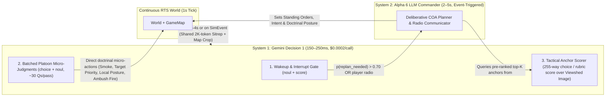

# Axis 2 Deep Dive: Language Models vs. Decision Models (`Gemini Decision 1` & `Jev`)

- **Parent Master Issue**: [#5](https://github.com/Mikhail-YellowBegonia/llm_wargame_test/issues/5)
- **Charter Reference**: [`00-research-charter.md`](./00-research-charter.md)

---

## 1. The New Paradigm (Sept–Nov 2026): What Are Decision Models ("System One Models")?

Until late 2026, building an AI game agent meant choosing between hardcoded heuristics/FSMs and generative Language Models (LLMs) that emit tokens sequentially via tool calls or JSON schemas. Between September and November 2026, a brand-new model category emerged—referred to by Google as **Decision Models** and by TypeSafe AI as **System One Models**:

| Attribute | Google `Gemini Decision 1` (`gemini-decision-1`) | TypeSafe AI `Jev 1.14` (`jev-latest`) | Generative LLM (e.g., `Gemini 3.7/3.8 Flash`, `DeepSeek V3`) |
| :--- | :--- | :--- | :--- |
| **Release Date** | November 11, 2026 (`v1beta` Decisions API) | September 15, 2026 (v1.14 in Nov 2026) | 2025–2026 |
| **Core Mechanism** | Single forward pass over shared input; scores closed-set options directly; **zero token generation** | Schema-constrained System-1 judgment over structured state (`text` / `JSON`); zero prose generation | Autoregressive token-by-token generation + multi-step tool calling |
| **Input Modalities** | **Omni-modal** (`text`, `image`, `audio`, `video`, `PDF`) up to **262,144 (256K) tokens** | `text` and structured `JSON` state blocks | Text / Multimodal (depending on model) |
| **Batching / Parallelism** | Up to **1,000 independent questions** evaluated in **one single pass** against 1 shared input | Multi-judgment batching over shared state | Sequential decoding (parallel tool calls still generate tokens serially) |
| **Primitive Question Types** | 1. `noul` (Yes/No $\rightarrow p \in [0.01, 0.99]$ + confidence) 2. `choice` (2 to **255 options** $\rightarrow$ winner + full probability distribution) 3. `score` (2 to 255 ordered rubric levels $\rightarrow$ continuous weighted score + per-level odds) | Boolean judgments (`0..1` probability), bounded `choice`, and rubric grading | Free-form text, tool calls, JSON |
| **Latency** | **50–100 ms** model compute (**150–250 ms** end-to-end) up to 16K context; **nearly flat from 1 to 100 questions!** | Sub-200 ms low-latency judgment plane | **1,500–8,000+ ms** per multi-step tool turn |
| **Pricing** | **\$0.10 / 1M input tokens**, **\$0 output tokens** (shared input billed once regardless of # of questions; free tier: 200 RPM / 10K RPD) | ~\$0.68 on 7-eval suite (vs. \$0.88 for Gemini Decision 1 and \$4.14 for Flash-Lite) | Input + expensive Output & Thinking tokens |
| **Calibration (Top-1 ECE)** | **0.0250** (lowest calibration error; probabilities reflect true empirical accuracy) | **0.0494** (strong on `When2Call` 82.0% & `Mind2Web` 86.8%) | **0.2104** (poorly calibrated confidence when prompted for probabilities) |

---

## 2. Capability Boundaries & Architectural Pitfalls (能力边界与常见误区)

As the user noted, Decision Models are brand new (Nov 2026), and most developers do not yet understand their exact boundaries. Our survey of Google's Decisions API documentation, independent benchmarks (Artificial Analysis Decision Index v2.1), and TypeSafe AI's engineering post-mortems (*"Don't Call It a Decision Model: Jev makes judgments, code makes decisions"*, Nov 3, 2026) reveals **four hard boundaries**:

### Boundary 1: The Conditional Independence Trap (问题间的条件独立性陷阱)
In `Gemini Decision 1` and `Jev`, when you send 1 shared input and $N \le 1,000$ questions in a single request:
- **Questions cannot see each other's answers.** Question $q_i$ and Question $q_j$ are evaluated completely independently in parallel heads over the shared input.
- **Implication for RTS**: If you ask Question 1: *"Which objective should Alpha 1 attack? {Choice: Obj North, Obj South}"* and Question 2: *"Which objective should Alpha 2 attack? {Choice: Obj North, Obj South}"* in the same parallel pass without coordination constraints, both questions see the exact same shared input and may make conflicting or uncoordinated choices!
- **Solution**: Either:
  1. Use the Decision Model to **score/grade (`score` / `noul`) the underlying tactical matrix** (e.g., score each platoon's suitability/risk for each anchor, resulting in a $3 \times M$ probability matrix in 150ms), and let 10 lines of deterministic TypeScript (e.g., Hungarian algorithm / greedy assignment) pick the conflict-free combination; OR
  2. Have the System-2 LLM (`Alpha 6`) set the high-level COA/role allocation, and use the System-1 Decision Model for platoon-local micro-judgments.

### Boundary 2: The "Prompt Gymnastics" Anti-Pattern (避免把确定性数学塞进选项描述)
TypeSafe AI's Nov 2026 analysis highlights the #1 failure mode when engineers adopt `Jev` or `Gemini Decision 1`:
- **Naive Anti-Pattern**: Creating one giant `choice` question (*"What should Alpha 1 do right now?"*) and stuffing paragraphs of arithmetic rules into the option `criteria` (e.g., *"Pick `retreat` if suppression > 60% and enemy tank is within 1500m and in LOS..."*).
- **Why It Fails**: Artificial Analysis's Decision Index v2.1 scores `Gemini Decision 1` and `Jev 1.14` at **66** (mid-pack) when tested on compound multi-hop logic tasks, even though their calibration (ECE 0.0250) on focused judgments is world-class.
- **The Golden Rule (*"Models make judgments; code makes decisions"*)**:
  - **Code computes exact facts (`F1..Fn`)**: Range, LOS, elevation difference, suppression %, ammunition, armor vs. penetration, order in-flight status.
  - **Decision Model evaluates fuzzy/contextual judgments (`J1..Jm`)**: *"Is the enemy contact probing or launching a main armored assault?"*, *"Does the player's radio message imply urgency over force preservation?"*, *"Which of these 12 pre-filtered hull-down anchors best covers the likely enemy avenue of approach?"*
  - **Code combines `Facts ∧ Judgments` via explicit thresholded logic** (using the calibrated probability $p \ge \tau$ and confidence score).

### Boundary 3: Statelessness & No Context Caching
- `Gemini Decision 1` has **no conversation memory, no tool calling, no thinking tokens, and no context caching** (every request bills its shared input tokens in full, though at only \$0.10/1M tokens, a 2,000-token sitrep + map image with 100 parallel questions costs only **\$0.0002 per call**!).
- Latency (150–250 ms) holds for shared inputs up to **16K tokens** and **1–100 questions**; feeding 200K+ tokens into every tick would break the real-time latency envelope.

### Boundary 4: No Generative Communication
- A Decision Model cannot write a radio transmission back to `Steel 6` ("Steel 6, Alpha 6, taking heavy ATGM fire from Ridge 2432, popping smoke and shifting Alpha 2 to the reverse slope"). Only a generative Language Model can synthesize natural-language radio C2 and open-ended multi-step plans.

---

## 3. Where Decision Models Are a Literal Game-Changer in Our RTS

By combining **System 1 (`Gemini Decision 1` / `Jev`)** and **System 2 (Generative LLM)** in a **Dual-Process C2 Hierarchy**, we solve the hardest problem in LLM-RTS design: **how to achieve 200ms tactical responsiveness and nuanced micro-decisions without burning LLM tool-call latency or hardcoding brittle FSM rules.**

### Concrete High-Value Use Cases for `Gemini Decision 1` in Agent v2

#### Use Case 1: Intelligent Wakeup & Interrupt Triage Gate (Replacing Dumb Timer/Event Wakeups)
Currently in `src/agents/commander.ts`, `Alpha 6` wakes up on *any* `inbox` string after a 4s debounce, or every 180s on a heartbeat. Once Stage 2 adds stealth spotting, 4-tier suppression, and artillery/smoke, raw simulation events will either spam the System-2 LLM or (if heavily filtered by hardcoded rules) miss subtle tactical shifts (e.g., an enemy recon unit flanking an unguarded crossroads).
- **With `Gemini Decision 1`**: Every 3–4 game seconds when state deltas occur, we send the compact Sitrep + active Commander's Intent (~1,500 tokens) and ask 5 `noul` / `score` questions in a **single 150ms pass**:
  - `q_replan`: (`noul`) *"Does the new battlefield development invalidate Alpha 6's current plan or require new multi-platoon orders?"*
  - `q_report_superior`: (`noul`) *"Is there a significant development (new threat axis, heavy casualties, objective status) that Steel 6 expects a radio report on?"*
  - `q_urgency`: (`score` 0..4) *"Rate the tactical urgency of the current situation."*
- If `q_replan.prob < 0.5` and `q_report_superior.prob < 0.5`, **we skip the expensive System-2 LLM call completely!**

#### Use Case 2: Batched Platoon Micro-Tactics in One Pass (Up to 100 Questions / 200ms)
In that **exact same 150ms API call** (paying for the shared input tokens **zero extra times**!), we attach 15–30 platoon-level micro-judgment questions (`noul` and `choice`):
1. **Defensive Smoke Trigger (`noul` per platoon/mortar)**:
   - *"Should `Alpha 1` pop defensive smoke / request mortar smoke right now given its suppression, armor exposure, and current mission intent?"*
2. **Target Prioritization (`choice` among visible contacts in range)**:
   - Instead of hardcoded `closest visible enemy` (`src/sim/world.ts` line 135), ask `Gemini Decision 1` to pick the highest-priority target (`choice` from $2..N$ visible contacts) considering threat type (e.g., an ATGM team threatening friendly armor vs. pinned infantry) and `Alpha 6`'s intent!
3. **Ambush / Fire Discipline (`choice`: `hold_fire_ambush` | `open_fire_now` | `fire_and_scoot`)**:
   - In Eugen wargames, letting an enemy tank column advance into a 1,200m kill sack before opening fire with flanks/ATGMs is the difference between victory and defeat. A `choice` judgment conditioned on the commander's intent can hold fire until the kill probability peaks, then trigger `open_fire_now` with 150ms latency.
4. **Local Reverse-Slope / Cover Adjustment (`choice` among 2–8 adjacent micro-anchors)**:
   - *"Should `Alpha 2` crest the ridge to engage now, or pull back 100m into reverse-slope defilade to shed suppression?"*

#### Use Case 3: Multimodal 255-Option Tactical Position & Fire-Support Scorer
Because `Gemini Decision 1` supports **up to 255 choices (`choice`)** and **multimodal image + text inputs** in a single pass:
- The engine can sample up to **64–128 candidate tactical grid anchors** across an Area of Operations (annotated with terrain, elevation, cover, and viewshed metrics, plus a rendered map crop) and ask `Gemini Decision 1` in **one 200ms forward pass**:
  - `best_overwatch_alpha1` (`choice` over 64 candidates): *"Select the best hull-down or treeline overwatch position for Tank Platoon Alpha 1 to cover Crossroads X while masked from northern ATGM ridge."*
  - `best_reverse_slope_alpha2` (`choice` over 64 candidates): *"Select the best reverse-slope ambush position for Mech Infantry Alpha 2."*
  - `best_smoke_line` (`choice` over 32 candidate lines): *"Select the best mortar smoke screen target to blind enemy overwatch during Alpha 1's advance."*
- Because `choice` returns **normalized probabilities for all 255 candidates**, our TypeScript code receives a complete **tactical probability heatmap** over the map in 200ms! It can either execute the top candidate directly or pass the top-3 highest-probability anchors to the System-2 LLM (`Alpha 6`) so `Alpha 6` never has to guess raw coordinates or waste tool steps calling `describe_location` in a loop.
